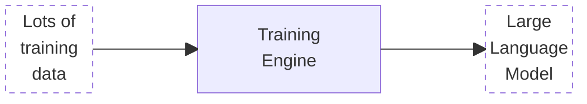
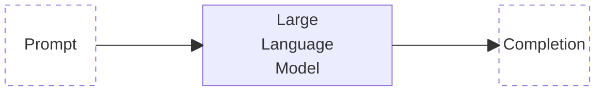

While generative AI, specifically large language models (LLM) is relatively new, it fits the same digital infrastructure patterns as other IT.
Let's start by understanding what the most important data is, where it is stored
and how it is processed.

A core element of AI systems is a trained model.
This is especially true for the dominant form of AI these days: deep learning neural networks, which power image recognition and services such as ChatGPT.

A trained model is the result of processing a lot of training data by a specific neural network.
These models are fixed in size, but typically very big.
The smallest useful models are close to a gigabyte, while recent public chat models are rumored to run into multiple terabytes.
LLM training costs thousands, millions, or more hours of compute time on specialized hardware.
This can take weeks, even on clusters of thousands of GPUs.

A trained language model is effectively a piece of software. You feed it text (also known as the prompt), and text comes out.
This is called inferencing, and it requires that the entire model fit into RAM memory.
Only for the simplest cases is this possible on a high-end laptop.
For more interesting use cases, you'll need a lot more hardware.
Therefore there is a good business case for sharing this across many users.

In cloud computing, we would call this Inference as a Service.
In the NIST cloud model, we'd call this SaaS or PaaS, depending on whether it is consumed directly or as part of a larger application.
As a side note, the Inference provider only needs to store your prompt for the duration of the conversation.
In reality it often stores it much longer, and your contract with the inference provider states if they use your prompt for training the next model, or not.

This gives us the option to look for this on the market, or create a shared service inside an organization or group of organizations (e.g. private or community cloud).
It also implies that we need to have a clear definition of the service and related service level objectives. 
This includes any allocation of security responsibilities.
