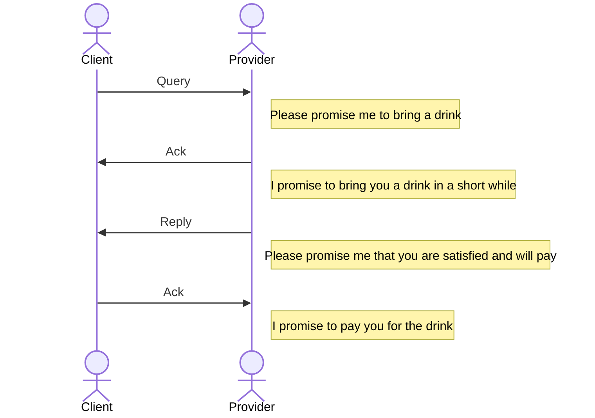

Digital infrastructures focus on services rather than products, making it elusive to capture the essence of these services, especially in defining the fluid interactions between service providers and consumers.

Promise theory is a little-known approach to interaction, though it has quite a few great thinkers behind it.
Introduced by Mark Burgess and others, it is about how autonomous agents work together.
It helped me a lot in getting a handle on various distributed systems.
There was this project where we designed a scalable travel information system with what we now call microservices.
We needed to describe how these parts work together.
And there was a project that required lots of independent and autonomous social security agencies to work together on providing a service.
In getting this from the drawing board to actual production, promise theory turned out to be a great tool.

Let's start with the basics, and we'll cover some of the background details later.

Imagine you are in a café or restaurant, and you wish to avail yourself of the service to order a beverage.
You have the attention of the waiter, and you politely ask them for a coffee. The waiter responds with a "yes, by all means" statement. After a while, the waiter returns with the coffee and says "there you go", to which you reply "thank you!"

This is a transaction between two autonomous agents. Both have the option to not participate.

Now what is really going on here?

Our question to the waiter is really a request for a commitment.
We want the waiter to commit to delivering us the coffee.
The "yes, by all means" statement amounts to an acceptance of this commitment.
Once the coffee is there, the statement "there you go" in fact signifies a request to be acquitted of the earlier commitment, that is to say: a declaration that the commitment is fulfilled.
And once we say "thank you", we have answered to that acquittal request, and stated that there are no more open commitments.

This basic interaction is an enormously universal pattern as we will see, and it can be used to describe interactions on many levels.
I have examples ranging from technical internet protocols to the organization of service management and legal contracts.

But before we move on, I'll have to discuss some variations that allow you to see how universal the pattern is.

- Some of the steps can be combined, or are implicit.
- The two steps by the provider can be combined if there is little time delay between them.
- The final acquittal can be implicit.
- What we have described is the "happy path". Alternative messages are also possible. The waiter can refuse the request: "We ran out of coffee unfortunately". We may not accept the drink: "Could you make that an iced latte, please".

Another point to make is that these transactions are often part of a bigger picture.
For example, once we accept the coffee, we are making an implicit promise to pay for it, at some later stage.
Though you can also envision scenarios where putting your money on the counter of the barista is an implicit acquittal.

Many, if not most, business transactions can be modelled with this, as we will see.
The key is to understand what the promises are that are being made and acquitted.

### IT support is also a service

Let's turn our attention to an example in digital infrastructures: we want a new laptop.
Again, this proceeds by making a request, in this case typically to a service desk.
It is the exact same flow of messages, although there may be more detail involved and a paper or web form needs to be filled in.

In our example, we have humans trading with humans.
But the same principles hold between humans and machines, machines and other machines, as well as between organizations and machines.
The core idea is that we are describing how agents transact.

Once we understand and describe the essence of such a transaction, we can automate it without changing the meaning.
That is a very powerful insight in a cyber world.
As an organization, we want to have machines service our customers.
And as customers, we don't seem to mind talking to a website as a substitute to talking to an organization.

In the course of the 20th century, most countries completed the automation of their telephone systems.
Requesting a call through an operator was replaced by "direct dialling", or self-service as we would call it in other situations.
As late as the 1970s there were destinations you could not directly dial, even in developed countries.

But the principle of setting up a call is the same, whether you ask a human or a machine.
It starts with "please connect me with this number".
And the general promise, the commitment, of the telecommunications company remains to do that, irrespective of the technology.

### What is a promise?

According to [Jeff Sussna](https://www.oreilly.com/library/view/designing-delivery/9781491903742/), a promise is 

> ... a strongly stated intention to provide a service, which may or may not be kept.

This makes it clear that there ultimately is a possibility for it to not be fulfilled.
Jeff Sussna compares this to a teenager's promise to clean their room.
It may happen, but there is a chance it does not.

Autonomous agents, also referred to as a *actors*, can only make promises to each other, they cannot force each other to do things.
However, we can *ask* other agents to make a promise to us.
In our example, we ask the waiter to bring us a coffee.
The waiter may chose to respond by making the actual promise.

The next important construct is the *conditional* promise.
An example would be: "If you bring me a coffee, I will promise to pay you for it".

With these basic primitives, we can model a lot of conversations.

Our example coffee conversation now becomes:

- Query: Please promise me to bring a drink
- Ack:  I promise to bring you a drink in a short while
- Reply: Please promise me that you are satisfied and will pay
- Ack: I promise to pay you for the drink

### Semantics

We can dive a little deeper into what such a promise means.
In all our examples, messages were exchanged between agents.
These messages control a process of interaction, and in that interaction, a shared reality is created.
This sounds abstract, I know, so let's have an example.
At a marriage, the magic sentence is:

> I now pronounce you husband and wife.

What changed after that sentence is said?
Legally, these people are now married, which creates a whole new world of possibilities and obligations.
Before that sentence was spoken, they were not married.

That is why this is also called "speech act theory": the statement acts upon our reality.
In the theory this example is a "performative" or "declarative" statement.

This view of messages helps us see how our interaction is a shared reality between the agents, and can actually control that shared reality.
That reality can be about the physical world, as in our coffee example, or it can be about the legal world that we use to control the physical world, as in our matrimonial example.
It can also be about the information world, such as access rights to data, or control over a virtual server.

The beauty of this is that we have a lean and unifying framework that ties together services, contracts, resources, control, human and machine communication.

### Tool in automation

Because we have this common language, we can now use this to describe an interaction process between humans, and then talk about how to automate that interaction.
The agents can change from man to machine without the promises changing.
We'll have some examples of that elsewhere.

### Contracting

In the above we have assumed that the promises just exist, fixed and immutable.
But we can also apply the theory and language to the creation and modification of these sets of promises.

How does the customer know that they can ask for coffee, not to mention being confident that they will not be charged outrageously?

That is because the café has a large blackboard on the wall that effectively says:

>We promise that, if you ask us to promise to bring you coffee, we will do so, under a set of conditions.

And there are a lot of conditions. The price is just one of them.
The conditions aren't all set by the café.
They can also originate from civil law, for example, or local municipality regulations.

By the way, in promise theory you can never ask an agent to do something.
You can only ask them to *promise* to do something.

In this scenario, you enter into a contract implicitly the moment that you place your order.
If you only order a single coffee, there is not much distinction between the contract and the order.
But if you are in a multicourse meal in a restaurant, it is different.
You have a contract when you accept the table.
Then there will typically be a sequence of food and beverage orders that will be rolled up into a single payment.
Typically.
