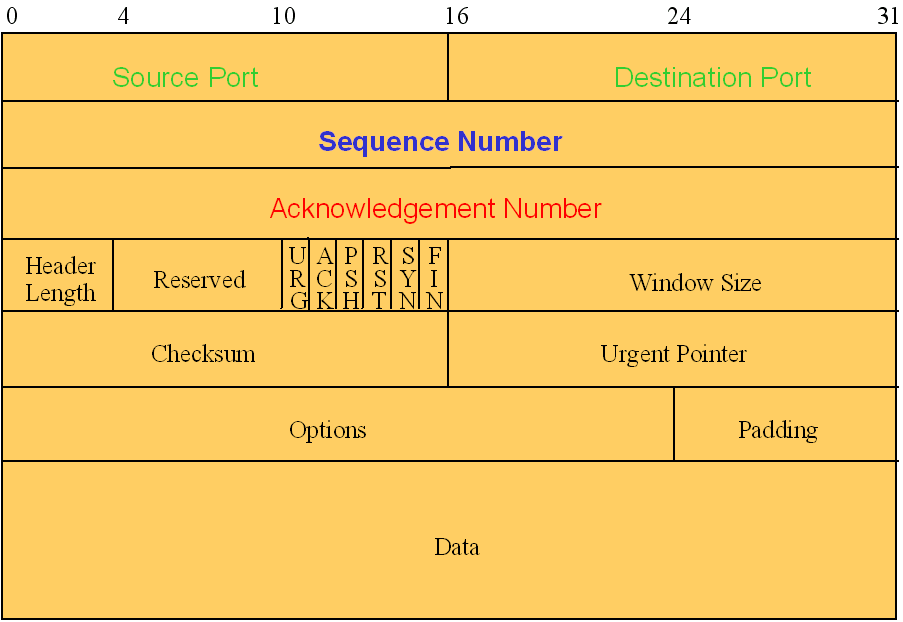

Let's dive a little deeper into the mechanics of defining services, in particular services in digital infrastructures.
A big difference between a service and a product is that interaction between consumer and provider typically keeps going on, long after the initial purchase.

### Service elements

Many interactions are about a resource that one party has, and the other party is interested in.
An IT services organization deals with customer requests like these all the time.

>Can I get a new laptop?

The resource is the new laptop.

>Joe from accounting needs permissions to access this application. Can you fix that?

The resource is the account and its permissions.

>I think I clicked on a phishing link. What now?

The resource is the procedure to be followed in this incident.
But the resource is also the user's device, which is now potentially compromised, which is a concern for the service desk.

The list is endless.

Most of these scenarios can be described very nicely with promise theory,
and in fact promise theory gives us a handle on analyzing and designing them.

Let's look at some examples of the elements of a service: the resource,
the consumer action and the related provider responses.
My rule of thumb is that a resource is anything that can be governed by a permission or can lead to a commitment or obligation.

- Access resource (login, get webpage, …)
- Create resource (server, virtual disk, mailbox, …)
- Modify resource (bigger disk/mailbox, new functional module, add friend on your socials, …)

Each of these is a request for a promise that affects the resource, and the response is (ideally) an acquittal.

On a different level we control the resources that control the resources, such as a user owning a certain file.

- Create user (provisioning)
- Create account
- Talk to a sales representative
- Negotiate and set up contract
- Reset password
- Delete account
- Delete data (deprovisioning)

### Service hierarchies

Earlier we discussed sitting in a restaurant, ordering one thing after another.
That is actually a *hierarchy* of services.
The bottom level is just a set of services requests: can I get a drink, can I get a main course?

This next level bundles a set of promises around this, and asks for promises such as: can I get a table for two, and have my food and beverage wishes fulfilled.
So at one level you will ask for a promise to have a response to more detailed promises.

Here is a technical communications example: TCP, the dominant connection protocol of the internet.

In setting up a connection with a flow of data, it is important to not overwhelm the recipient with more than they can handle.
The recipient will buffer the data, but the buffer is not infinite.
Yet you also don't want to send too little data, as that slows the flow.

Good connection management requires both parties to collaborate in this.
The core technique for that is the 'sliding window' protocol, in which you can have a certain maximum of unacknowledged data outstanding.

Here is what it looks like as a set of promises:

> Connection initiator: can you promise to reserve buffer space for a connection?
>
> Connection responder: I promise to reserve space, so I can accept all the data that is within the window size I am giving you.

The transmission phase has its own promise conversations.

> Q: please accept this data
>
> A: thank you, I will forward it, here is your new window size

The window size is an essential part of most data exchanges.
The diagram shows its place in the TCP packet header.

The same mechanism plays out in other situations.
Here is a scene from a coffee shop I once witnessed.

> Order taker to Barista: ready for next order?
>
> Barista to Order taker: yes, I will promise to process the next order in time.
> 
> alternatively:
>
> Barista to Order taker: no, I am overloaded, but I will let you know when I have capacity again.

Again, it is a promise about a promise. The barista promises to listen to an order and promise its delivery. The TCP recipient promises to wait for a specific amount of data, and then promise its further delivery.

Generally, there is a hierarchy of services.
A contract starts and finishes, for example a corporate account for mobile phones.
In the contract there is provisioning: employees onboard and leave.
In an individual phone subscription, the user starts a connection and terminates it.

And still: on all levels these promises can be made by humans or by software and machines.

### Service levels and quality

In the coffee shop example, the barista refuses orders so that they can
guarantee a delivery time of the coffee orders that are in progress.
That number is not often advertised to customers,
but I understand it is certainly communicated to staff as an objective.

Once we see services as a set of promises, and promises made and acquitted through messages, we can put numbers on the quality and levels of services.

You don't want to wait too long for your coffee, but what do you call too long?
More specifically, you can measure the time between the promise of the order taker and the delivery by the barista.

In the same way you can measure the time between you clicking on a link in a web page and the complete delivery of the next page.
We call that the response time.

Other examples: how fast does your new laptop get delivered, your new cloud server, and so on.

With incident management it is a little more complicated.
You can measure the time between your call and the *beginning* of the work on your call, which is what incident responders often call the response time, confusingly.
You can even measure the time it takes before you get a real human to listen to your problem.
You can measure the time between your call and the *end* of your incident.
However, incident response teams don't like that as a promise, because they might not have sufficient control over that.
You can also measure the time between your call and the resolution of your incident, or the escalation to another level, whichever comes first.

Service providers often make these promises conditional on volumes.
If you have a contract to regularly get a few laptops delivered withing 24 hours, the provider would be wise to put an upper limit to the number of laptops.
Otherwise they run the risk that you suddenly demand one thousand laptops, which is likely to make the provider break their promise.
The promise they want to make is dependent on the way they run their business.
The promise you want is important for the way you run your business.

Here is where it sometimes goes wrong in digital services, especially in new services.
Neither party fully understands their requirements and the capabilities of the technology.
But both are willing to give it a try, so they get started before they can finalize the service levels.
As the services become more successful, the service levels need to be agreed upon, instead of just being assumed.
Do this too early, and you will get stuck in defining things you don't understand well enough.
Do this too late, and at least one of the parties will be seen as unwilling to make promises,
and the respective business processes don't match.

Performance contracts are nothing new in any business or industry, and entire books have been written on Key Performance Indicators, Service Level Objectives and more.
Making it measurable for digital infrastructures is a little harder.

### Probability and risk

The real world isn't perfect, which is one of the assumptions of promise theory.
But some worlds are more perfect than others, and here is where chance and probabilities play a role.
That is why we talk about 99.9% uptime, or 99.99%.
You can read this as the chance that promises are kept.
We will have a more detailed look at those numbers when we talk about trust.

For the moment we focus on the engineering side.
Whether these probability promises are adequate depends on the risk that failure brings.
There is a business side and a technical side to this.
On the business side: is this promise adequate for my customers?
For example, the uptime of my e-commerce site is a lot more important than the website that hosts the company cafeteria menu.
Technically, our underlying services need to support the technical services that we are delivering.
A website can't easily run 99.9% uptime if its servers are crashing all the time.
Aligning these requirements and promises on all control boundaries is architecture, and needs collaboration from business and technical architects with a healthy dose of risk analysis.

Ultimately, the point of this unit is that, again, promise theory and its associated tools can be applied on the entire spectrum of things that make digital infrastructures work, from the nitty gritty technical details to the broadest business concerns.