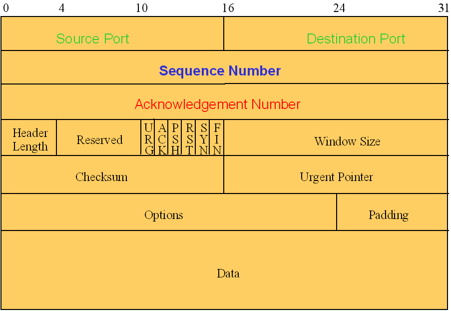

We have introduced customer service as a great thinking model for a lot of what is going on in digital infrastructures, even if the customer is not a human.
We are often buying products, but we really mostly want a service.
In an earlier unit, we talked about promise theory

### Service elements

An IT services organization deals with customer requests all the time.

>Can I get a new laptop?
>
>Joe from accounting needs permissions to access this application. Can you fix that?
>
>I think I clicked on a phishing link. What now?

The list is endless.

Most of these scenarios can be described very nicely with promise theory,
and in fact promise theory gives us a handle on analyzing and designing them.

Service elements: consumer actions and provider responses 

Every service has multiple components/elements, i.e.
Access resource (login, get webpage, …)
Create resource (server, virtual disk, mailbox, …)
Modify resource (bigger disk/mailbox, new functional module, add friend, …)
Create user (provisioning)
Create account
Talk to a sales representative
Negotiate and set up contract
Reset password
Delete account
Delete data (deprovisioning)

Generally: anything that can be governed by a permission or can lead to a commitment or obligation

### Service hierarchies

Earlier we discussed sitting in a restaurant, ordering one thing after another.
That is actually a *hierarchy* of services.
The bottom level is just a set of services requests: can I get drink, can I get a main course?
The next level bundles a set of promises around this, and ask for promises such as: can I get a table for two, and have my food and beverage wishes fulfilled.
So at one level you will ask for a promise to have a response to more detailed promises.

Example TCP/IP

In setting up a connection with a flow of data, it is important to not overwhelm the recipient with more than they can handle.
The recipient will buffer the data, but the buffer is not infinite.
Yet you also don't want to send too little data, as that slows the flow.

Good connection management requires both parties to collaborate in this.
The core technique for that is the 'sliding window' protocol, in which you can have a certain maximum of unacknowledged data outstanding.

Here is what it looks like as a set of promises:

Initiator: can you promise to reserve buffer space for a connection?
Responder: I promise to process all the data that is within the window size I am giving you.

Connect
Q: can you reserve buffer space for a connection?
R: yes we promise, here is your initial window size
A: thank you, here is your initial window size

Transmission
Q: please accept this data
A: thank you, I will forward it, here is your new window size

Hierarchy of services
Extra note: can you group these in phases: contract, provision, use..
Contract (start – end)
Provisioning users within a contract, deprovision
Using resources by a user

some can be automatic, some still human

### Service levels and quality

Or a coffee shop example that I once witnessed.

Order taker to Barista: ready for next order?
Barista to Order taker: yes, I will promise to process the next order in time, or no, I am overloaded, but I will let you know when I have capacity again.

putting a number to it.

Response times for primary service
Provisioning latencies of users, instances, network, disks, 
Minimum/maximum volumes
Cost per user; typically registered user, not per concurrent user
Latency and volumes of calls.
Network latency by location
Software resources (e.g.  # connections)
Incident response times

